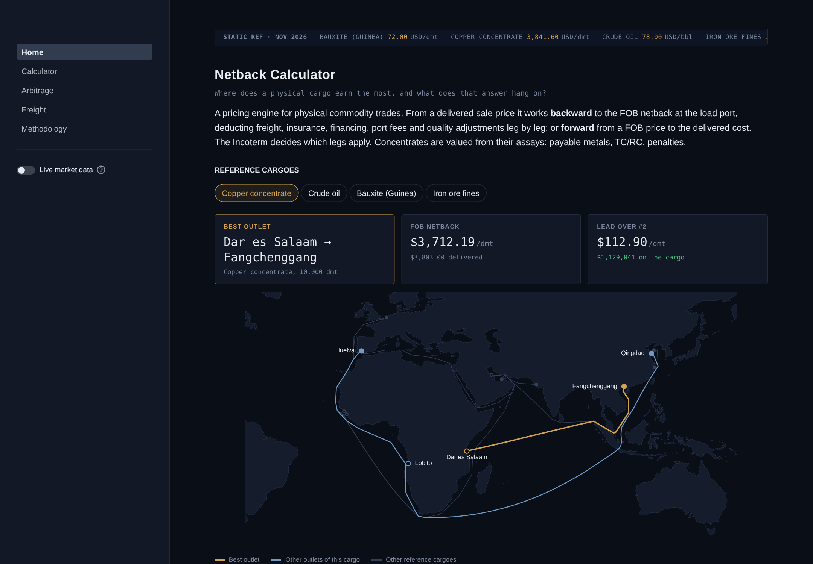
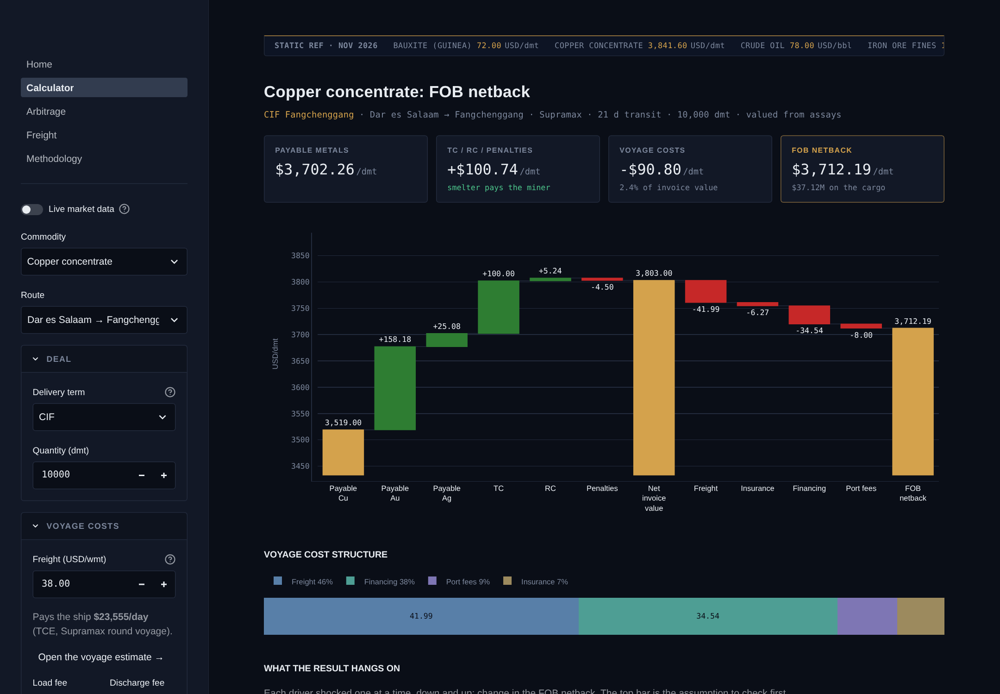
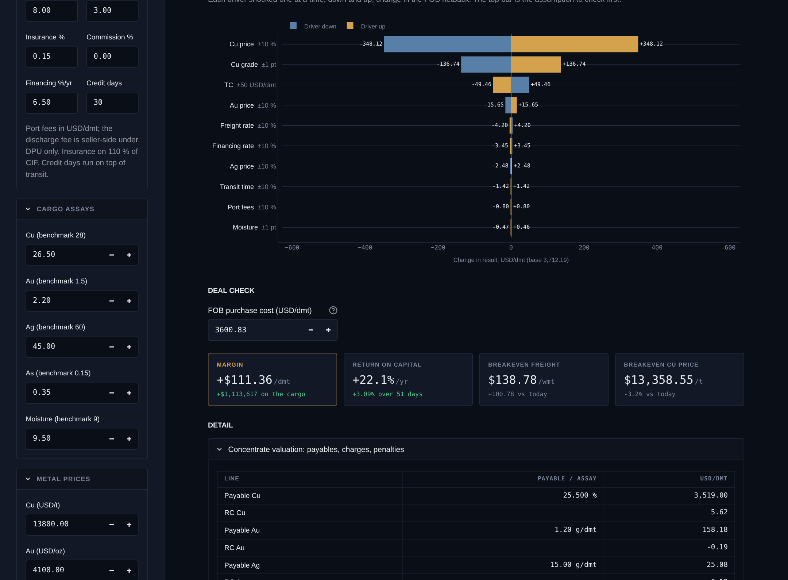
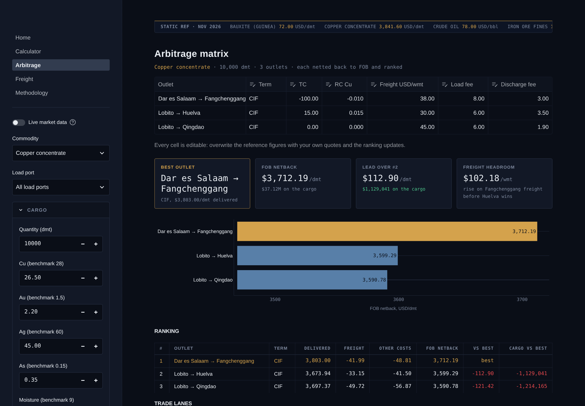
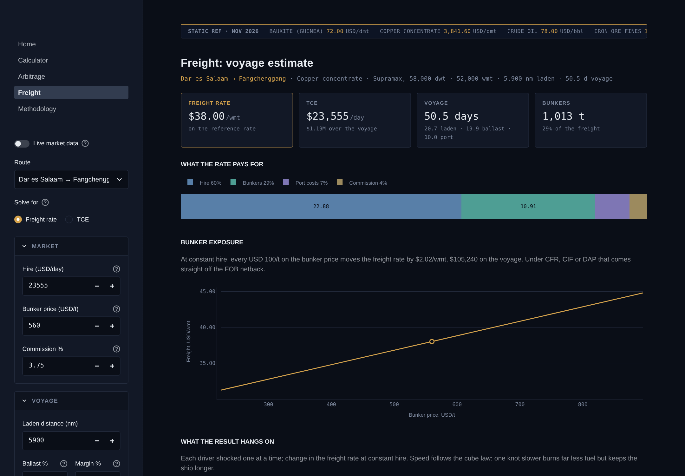
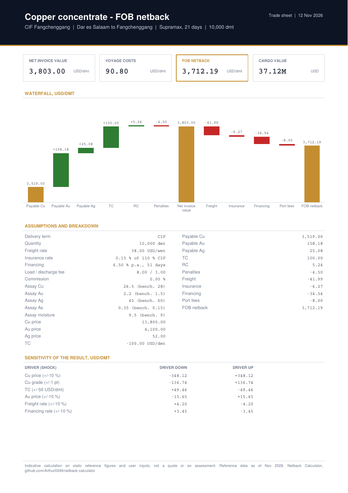

# Netback Calculator

[](https://github.com/Arthur0349/netback-calculator/actions/workflows/tests.yml)
[](LICENSE)

**Where does a physical cargo earn the most, and what does that answer hang
on?** A netback and landed-cost engine for physical commodity trades, wrapped
in a dark trading-terminal Streamlit app.

From a delivered sale price (CFR/CIF/DAP/DPU) it works backward to the FOB
netback at the load port, deducting freight, insurance, financing, port fees
and quality adjustments leg by leg; or forward from a FOB price to the
delivered cost. Concentrates are valued from their assays: payable metals,
TC/RC, penalties.

## What it does

| | |
|---|---|
| **Calculator** | One voyage end to end: waterfall from price (or payable metals) to FOB netback, cost structure, tornado sensitivity, deal margin with breakeven freight and price, one-page PDF trade sheet, shareable link to the exact case |
| **Arbitrage matrix** | One cargo, every outlet, each with its own price or smelter terms, freight and port costs; ranked on FOB netback with the lead over the runner-up and the freight headroom before the ranking flips. Every cell editable |
| **Freight** | Voyage estimate: from hire, bunkers, port and canal costs to a freight rate, or from a quoted rate back to the TCE it pays the ship; bunker exposure, slow-steaming sensitivity; pushes the rate into the Calculator |
| **Route map** | Every trade lane drawn along its sea route, coloured by netback rank |
| **Live market data** | Copper, gold, silver, Brent, iron ore and SOFR from public delayed quotes, with a per-figure fallback to the static reference set |
| **Methodology** | Every formula and convention, no black box |

**Home**


**Calculator: copper concentrate, from payable metals to FOB netback**



**Arbitrage matrix**


**Freight: voyage estimate**


**Trade sheet (PDF export)**



## Trading conventions built in

- **Incoterms decide the legs.** Insurance applies from CIF up, discharge
  handling only under DPU; load port fees are a seller cost below FOB.
- **Insurance on 110 % of CIF**, without double counting freight when the
  starting price is already delivered.
- **Wet vs dry tonnes.** Dry bulk freight is quoted per wet tonne, ore is
  priced per dry tonne: the engine converts with the cargo moisture.
- **Concentrates.** Payable content is the lower of a payable percentage and
  the assay minus a minimum deduction; RC per payable lb (base) or oz
  (precious); pro rata penalties; negative TC/RC supported (2026 benchmark:
  USD 0/dmt and 0 c/lb, spot well below zero).
- **Freight is built, not assumed.** A voyage estimate turns hire, bunkers,
  port and canal costs into USD per tonne, and a quoted rate into its TCE;
  speed follows the cube law. Reference transit days use the same speeds.
- **Sensitivity and breakeven.** One driver shocked at a time; breakevens
  solved exactly (the result is linear in freight and price).

## Coverage

| Commodity | Pricing | Routes |
|---|---|---|
| Copper concentrate | Assays: payable Cu/Au/Ag, TC/RC, As penalty | Lobito → Qingdao, Lobito → Huelva, Dar es Salaam → Fangchenggang |
| Iron ore fines | 65 % Fe index, Fe/SiO2/moisture escalators, CFR | Morebaya → Qingdao, Rotterdam |
| Bauxite (Guinea) | CIF index, Al2O3/SiO2 escalators | Kamsar → Yantai, Khalifa Port |
| Crude oil | Medium-sour benchmark, API/sulfur escalators | Ras Tanura → Ningbo, Rotterdam, Sikka |
| Spodumene concentrate | Config-only skeleton | manual inputs |

The engine knows nothing about any specific commodity: each one is a
**configuration profile** (unit, benchmark spec, quality formula or
concentrate terms) in
[`commodity_specs.json`](src/netback/data/reference/commodity_specs.json).
Spodumene is the proof: a JSON edit, no code change.

**About the numbers.** With live data on, metal prices, Brent, iron ore and
SOFR come from public delayed quotes (Yahoo Finance futures, New York Fed);
a quote that fails or looks wrong falls back to the static figure, one
figure at a time. Freight, port fees, smelter terms and bauxite are static,
indicative figures (as of Nov 2026), chosen for internal consistency.
Destination price differentials, non-benchmark TC/RCs and vessel figures are
illustrative assumptions. Every input is editable in the app. Set
`NETBACK_LIVE=0` to start on the static set.

## Architecture

```
src/netback/
├── core/        # pure functions, no I/O: cost legs, concentrate valuation,
│                # netback orchestrator, arbitrage ranking, sensitivity,
│                # voyage estimate (freight from hire, TCE from freight)
├── models/      # pydantic schemas
├── data/
│   ├── providers/   # PriceDataProvider ABC, static tables, live quotes
│   └── reference/   # JSON tables: ports, routes, sea lanes, freight,
│                    # vessels, specs, live sources
├── reporting/   # PDF trade sheet (fpdf2)
└── sharing.py   # a case <-> URL query parameters
app/             # Streamlit UI: orchestration only, no business logic
tests/           # pytest, hand-computed reference cases per module
```

Strict separation of calculation / data / presentation: `core/` makes no
network calls and never imports Streamlit; the only network code is the
quote fetcher behind the live provider. Original design brief in
[`docs/architecture.md`](docs/architecture.md).

## Quickstart

```bash
git clone https://github.com/Arthur0349/netback-calculator.git
cd netback-calculator
pip install -e .
streamlit run app/Home.py
```

Run the tests:

```bash
pip install -e ".[dev]"
pytest
```

## Tech stack

| Layer | Choice |
|---|---|
| Engine | Python 3.10+, pure functions, pydantic v2 models |
| Data | JSON reference tables behind a `PriceDataProvider` ABC; live quotes over HTTPS with the standard library, no API key |
| UI | Streamlit multipage app, Plotly charts and route map, responsive down to phone width |
| Export | fpdf2, no browser or image backend needed |
| Quality | pytest (102 tests: hand-computed reference cases, live provider with injected fetchers, every page run headless), GitHub Actions on every push |

## Roadmap

- [x] Core cost engine, Incoterm-aware legs, wet-to-dry freight
- [x] Concentrate valuation: payables, TC/RC, penalties
- [x] Arbitrage matrix with per-destination pricing
- [x] Sensitivity, breakeven, deal check, PDF trade sheet
- [x] Live data (metal prices, crude, iron ore, SOFR) behind the provider interface
- [x] Voyage estimate: freight from hire, TCE from freight, bunker exposure
- [x] Route map and shareable case links
- [ ] Quotational period and provisional/final invoicing for concentrates
- [ ] Demurrage and laytime
- [ ] Hedging layer: hedged vs unhedged P&L, basis risk
- [ ] West African softs in containers (cocoa, cashew ex Abidjan / San Pedro)

## License

MIT, see [LICENSE](LICENSE).
